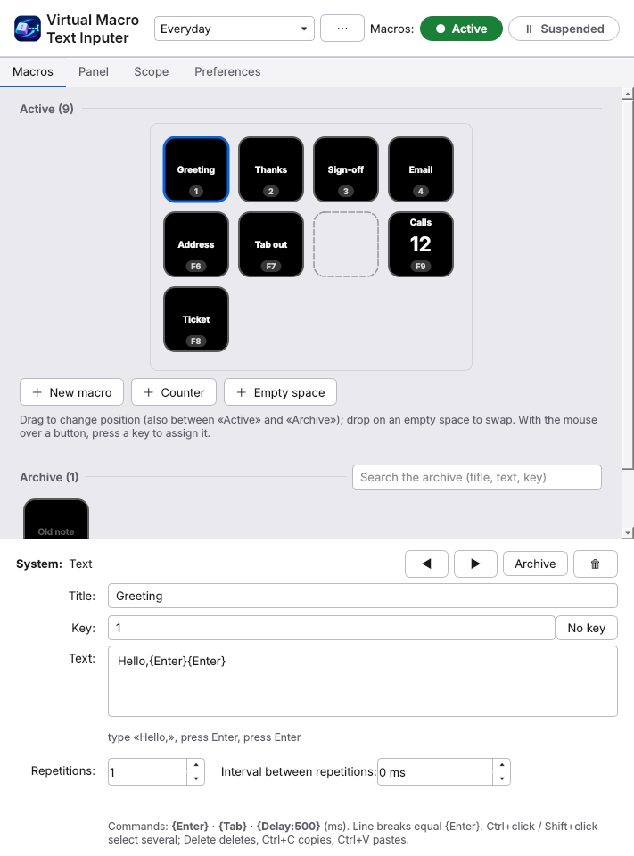
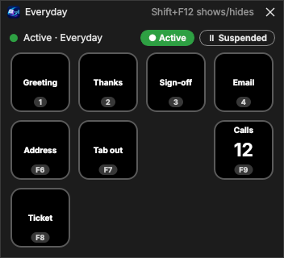

# Virtual Macro Text Inputer

*Documentação em português: [docs/pt/README.md](docs/pt/README.md).*

> Vibe-coded with Claude and reviewed by Codex.
>
> This app lets me quickly enter short text snippets by clicking a button on a transparent on-screen panel or pressing a keyboard hotkey. I asked Claude to build it to meet a very specific need at work. It was strongly inspired by Virtual Stream Deck. One day, I forgot to bring my physical Stream Deck, so I asked Claude to recreate the concept in software. Claude built the core functionality in a single pass, with no errors that I noticed.

<p align="center">
  
  &nbsp;
  
</p>

Until version 0.4 it was called **Macropad**. The Python package is still called `macropad`, so the `python -m macropad` commands are unchanged.

A macro pad for Windows. It uses ordinary keyboard keys (by default 1, 2, 3 and 4 on the top row) and an optional floating panel to type predefined text into the application in the foreground. When a macro fires, the original key is suppressed: pressing **1** types `3E03305` and the 1 does not appear.

- Runs in the background, with an icon in the notification area (next to the clock) and no visible windows.
- Closing the settings window or the panel does not quit the application. To quit, use the icon menu ▸ **Quit**.
- Starts with Windows by default (can be turned off in Preferences). It does not create desktop shortcuts.
- Only one instance can run. Opening the program again just shows the settings.
- **Name change.** On the first start under the new name, macros and preferences in `%APPDATA%\Macropad` are copied to `%APPDATA%\VirtualMacroTextInputer` (the old folder is left untouched as a backup). The old Windows startup entry («Macropad») is replaced by the new one. If the old version is still running, the program asks you to close it so that macros are not typed twice.

## Download

The [Releases](https://github.com/gama20000/VirtualMacroTextInputer/releases) page has `VirtualMacroTextInputer.exe`, a single file that needs no installation and no Python. Put it wherever you like (for example `%LOCALAPPDATA%\Programs\VirtualMacroTextInputer`) and run it.

- The executable is not digitally signed, so on the first run Windows SmartScreen may say «Windows protected your PC»: **More info ▸ Run anyway**. The `.sha256` file next to it lets you check that the download is intact (`Get-FileHash VirtualMacroTextInputer.exe`).
- A single-file executable unpacks itself to a temporary folder on every start, so it takes 1–3 s longer to open than the folder build. Some antivirus programs are wary of programs that read the keyboard and type text; if yours blocks it, build it yourself from source (below).

Every pull request (including Dependabot's) and every push to `main` runs the tests on Windows (`.github/workflows/tests.yml`). Releases are built by GitHub Actions on a clean Windows machine (`.github/workflows/release.yml`): pushing a `vX.Y.Z` tag that matches the version in `pyproject.toml` runs the tests, builds the executable and publishes the release.

## Getting the code

```powershell
git clone https://github.com/gama20000/VirtualMacroTextInputer.git
```

The maintainer's working copy has one `origin` remote with two push URLs (a private Forgejo and GitHub), so a single `git push` updates both.

## Running

Requirements: Windows 10/11 and Python 3.11 or later. Python is only needed to run from source or to build the distribution.

```powershell
# from source (with a console, useful to see errors)
.\run-dev.ps1

# or manually
python -m venv .venv
.\.venv\Scripts\pip install -e ".[dev]"
.\.venv\Scripts\pythonw -m macropad          # no console
```

### Building the Windows distribution

```powershell
.\build.ps1        # creates .venv, runs the tests and builds dist\VirtualMacroTextInputer\VirtualMacroTextInputer.exe
```

Or, for a single file: `.\build.ps1 -OneFile` builds `dist\VirtualMacroTextInputer.exe` and its SHA-256.

Copy the `dist\VirtualMacroTextInputer` folder wherever you like (for example `%LOCALAPPDATA%\Programs\VirtualMacroTextInputer`) and run `VirtualMacroTextInputer.exe`. The autostart registry entry (`HKCU\...\Run`) points to the executable that is running. If you move the folder, open the program once from the new location and turn "Start automatically with Windows" on again.

### Tests

```powershell
.\.venv\Scripts\python -m pytest -q
```

The tests cover command parsing, keys and modifiers, repetitions, cancellation (suspending during `{Delay}` and switching windows), per-application scope, TOML validation and reloading (including invalid files, atomic replacement, event coalescing and no reload loops), the simulated Win32 layer and a UI smoke test. Real key suppression and panel focus have to be checked by hand: see [docs/MANUAL-CHECKLIST.md](docs/MANUAL-CHECKLIST.md).

## Usage

**Icon next to the clock.** Click it to open the settings. The right-click menu lets you open the settings, show/hide the panel, choose the active set, suspend/resume macros and quit. The icon has a cyan outline when macros are **active** and turns grey with a red dot when they are **suspended**.

**Global suspend.** The suspend hotkey (`Shift+Escape` by default; anyone who had `Ctrl+Alt+P`, the previous default, is moved to `Shift+Escape` once, with a notice) toggles between active and suspended. It works even in the middle of a macro, including during a `{Delay}`, and immediately cancels the pending steps and repetitions. While macros are suspended, every key behaves normally. The state and the selected set are restored at the next start.

**Show/hide the panel.** The panel key (`Shift+F12` by default) shows or hides the panel from any application, also while macros are suspended. The key is shown in the panel's title bar and in the icon menu. You can change it, or leave it without a key, in Preferences ▸ «Panel key».

**Active / Suspended.** The top of the settings window has two buttons, **Active** (green when selected) and **Suspended** (red when selected). They do the same as the suspend hotkey and can be used with the mouse or the keyboard (Tab to the button and Space). The focused button has a visible focus outline.

**Settings.** Four tabs, in this order:
- *Macros*: two areas, **Active** and **Archive**, and the editor for the selected button. The **Active** area is centred and looks exactly like the real panel (size, colours, spacing, columns, title and key position); if it is large, the window scrolls. Valid changes are saved automatically.
  - **Drag**: drop a button before or after another to put it there (a blue line shows where it goes), within the same area or between **Active** and **Archive**, in both directions. Dropping on an empty space swaps the two. Dropping on the area title, or on an empty part of the area, puts the button at the end. Everything is saved immediately. The assigned key does not change. ◀ ▶ also change the order.
  - **Key**: click the **Key** field and press the key or combination; or, faster, hover the mouse over a button (the key label turns yellow, «Key…») and press the key. It is only assigned if no other active macro uses it and it is not the suspend or panel key; otherwise a warning appears, with a **Don't show again** option (turn it back on in Preferences ▸ «Warn when a key assigned with the mouse is already in use»). Over a button, Delete/Backspace, Tab, Ctrl+C, Ctrl+V, Ctrl+Z and Ctrl+Y keep their functions and Esc cancels. **No key** leaves the macro available only on the panel. **Media** assigns Play/Pause, Previous track or Next track without pressing them (pressing them to record would also control your music player); the same conflict checks apply. Suspended or outside the scope, media keys work as usual.
  - **New macro** adds a single macro, with no key and empty text, and puts the cursor in the **Text** field. **New macro**, **Counter** and **Empty space** insert the new item right after the selected macro in **Active** (after the last one if several are selected); with nothing selected, or with an archived macro selected, at the end of **Active**.
  - **Counter** adds a button that counts: a short click on the panel (or its key) adds the **step** (1 by default); while you hold it, the panel button shows the elapsed time as a line along its border, and when the **long press** time (800 ms by default) is reached the count goes back to the **reset value** (0 by default) at once, with a green flash, without adding and without waiting for you to let go (holding longer does not reset again). **Sound on reset** plays a Windows system sound on reset (none by default; **Test** plays it). A counter only shows the count; it types nothing. The count is stored in `estado.toml` and kept between sessions; **Reset now** in the editor resets it.
  - **Empty space** takes a grid position without a button. In the settings it is drawn dashed and can be dragged; on the panel it is invisible and does nothing, but keeps its place. Empty spaces do not go to the Archive.
  - **Red** (a «!» badge) marks an error, including a *key conflict* when two active macros have the same key. Errors are not saved.
  - **Yellow** (a «=» badge) marks *duplicate content*: macros with the same sequence of text and commands, even with different titles or keys (`{enter}`, `{Enter}` and a line break count as equal). Hover the button, or look at the yellow line in the editor, to see which macros it matches. Duplicates are only a warning and are saved.
- *Panel*: style, columns, rows (with more buttons than rows × columns the panel shows pages, with ◀ 1 / 2 ▶ arrows; with fewer it only takes the rows it needs), button size, spacing, corner rounding, border, text size, colours (button, text, border, background), title position and key position (top, centre, bottom; independent and never overlapping), visible elements (key, status bar, Active/Suspended buttons), «always on top» and opacity. The centred **preview** uses the same drawing as the real panel (including the Active/Suspended buttons) and updates on every change, without opening the panel. There are preset styles (Default, Compact, Large, Light, Neon, Round, Minimal, Title on top). **Restore default** goes back to the original look without touching columns, opacity or «always on top».
- *Scope*: the set works in all applications or only in the listed ones, identified by their executable, for example `notepad.exe`. Outside them, keys work normally and the panel does not send text.
- *Preferences*: theme, language, start with Windows, «Don't ask for confirmation before deleting macros», key-in-use warning, suspend hotkey, panel key, modifiers and text mode. Every change applies immediately. Starting with Windows is checked after it is applied (including the approval in Task Manager ▸ Startup apps); if it cannot be applied, an error appears below the option.
- **⋯** menu: new, duplicate, rename, delete, import and export sets, and open the configuration folder.

**Selecting several macros.** Ctrl+click adds or removes macros from the selection and Shift+click selects a range. With several selected, the **Archive (n)**/**Restore (n)** and 🗑 buttons act on all of them. Before deleting several, the program always asks for confirmation and shows how many.

**Grid shortcuts.** With one or more macros selected and the focus outside an edit field:

| Key | Action |
|---|---|
| Delete or Backspace | deletes the macro(s) (asks for confirmation) |
| Ctrl+C | copies the macro(s) |
| Ctrl+V | pastes copies after the selection, in the same area: a copy of an archived macro stays in the Archive, right after the original. If the key is already in use, an active copy gets no key |
| Ctrl+Z | undoes the last deletion: the macros come back in the same area and position, with the same settings and key (if the key has meanwhile been assigned to another macro, the restored one gets no key, with a message). Kept per set while the window is open |
| Ctrl+Y or Ctrl+Shift+Z | deletes them again |

With the focus in a text field, these shortcuts copy, paste, delete and undo text as usual. The delete confirmation has a **Don't ask again** option. To turn confirmations back on, untick Preferences ▸ «Don't ask for confirmation before deleting macros».

**Archive.** Below the active macros, the **Archive** area shows the archived macros, with a search box for title, text or key.
- **Archive** removes the macro from the keys and the panel without deleting it. It stays in the set file with `arquivada = true`. You can also drag an active macro, or the whole selection, into the **Archive** area: it is archived immediately, at the position where you drop it.
- **Restore** (or dragging it to **Active**) makes it active again. If its key is already assigned to an active macro, the program asks for confirmation. If you confirm, the restored macro takes the active one's place and that one moves to the archive. If you cancel, nothing changes. Archived macros with the same key restored together: only the first is restored and the others stay in the Archive.
- Archiving and restoring do not change previously exported files.

**Panel.** The panel shows the active macros in a grid, with title and key, and a status indicator (active / suspended / out of scope / running). It has its own title bar, in the theme colours, with the set name, the panel key and ✕ to hide it; drag it to move the panel (the position is saved). Clicking a button does not take the focus away from the application you are typing in, and the text goes there. It stays on top by default. Its look is configured in the *Panel* tab.
- The panel's **Active**/**Suspended** buttons share state and effect with the ones in the settings and do not take the focus away from the target application.
- With the pointer over the panel, the **mouse wheel** changes the transparency in 5 % steps (up is more opaque, down more transparent, between 20 % and 100 %). The level is shown briefly in the centre of the panel and saved. Only the panel is affected.
- If the wheel does not react while the panel is not focused, turn on the Windows setting «Scroll inactive windows when hovering over them».

**Theme.** Three options:
- **Day**: light interface with a black title bar.
- **Night**: dark interface and title bar.
- **Automatic** (default): follows the Windows setting (Settings ▸ Personalisation ▸ Colours ▸ app mode).

The choice applies to every window, including the panel and dialogs. The title bar colour can only be set on Windows 11. On Windows 10 the bar is black, or dark with the system dark mode.

**Language.** Português or English (Preferences ▸ Language). The choice applies to the whole interface, messages, menus and confirmations. Macro titles and contents, set names and field names in the TOML files are not translated.

To add a language, copy `src/macropad/locales/pt.toml` to `<code>.toml` (for example `es.toml`), change `nome` and translate the values. The new language appears in the list right away, and missing keys fall back to Portuguese. Names in braces (`{title}`) are filled in by the program. Literal braces are written `{{` and `}}`.

### Trigger rules

- By default (`modificadores = "exatos"`), only the bare key triggers. `Ctrl+1`, `Alt+1` and `Shift+1` keep their normal behaviour. You can also bind a combination to a macro, for example `Ctrl+F1`, which only triggers with exactly that combination. With `"ignorar"`, keys without modifiers also trigger with Ctrl/Alt/Shift/Win held.
- Keys 1 to 4 on the top row are different from `Numpad1` to `Numpad4`.
- Holding the key does not fire the macro again. You have to release it and press it again.
- While a macro is running, new triggers are ignored (the key is still suppressed).
- If the macro was triggered with modifiers held, execution waits for them to be released (up to 1.5 s). If they are still held, the macro is not run and a warning appears. This way an `{Enter}` is never sent as `Ctrl+Enter`.
- If you switch windows during execution, the pending steps are cancelled. In *Paste* mode the target window is checked again right before Ctrl+V.
- Text sent by the program never triggers macros. Keys pressed in the program's own windows do not either (except counter keys, which only count).

## Commands in the text

| Command | Effect |
|---|---|
| `{Enter}` | presses Enter |
| `{Tab}` | presses Tab |
| `{Delay:500}` | waits 500 ms (0 to 600000) |

Commands run in order, at the position where they appear. For example, `ABC{Tab}DEF{Delay:500}{Enter}` types ABC, presses Tab, types DEF, waits 500 ms and presses Enter.

- Names are case-insensitive (`{enter}` is the same as `{Enter}`). `{Enter}` and `{Tab}` are always commands.
- A line break in the text equals `{Enter}` and a tab character equals `{Tab}`.
- Malformed commands (`{Entr}`, `{Delay:abc}`, an unclosed `{Enter`) are errors, with their position. Other braces that do not form a command, such as `{}` or `{1}`, are literal text.
- The text can contain any Unicode character (accents, €, emoji).

**Text mode** (Preferences):
- *Simulate typing* (default) sends the characters as Unicode and does not depend on the keyboard layout.
- *Paste* copies the text to the clipboard and sends Ctrl+V. Useful in applications that do not accept simulated typing. The previous clipboard content is not preserved.

## Configuration files (TOML)

They live in `%APPDATA%\VirtualMacroTextInputer\`. Field names are in Portuguese and are not translated:

| File | Content |
|---|---|
| `config.toml` | general and panel preferences |
| `conjuntos\<id>.toml` | one file per set. The file name is the set identifier |
| `estado.toml` | session state (active/suspended, set, panel visibility and position, counter counts, migrations done). Managed by the program and not watched |
| `macropad.log` | error log |

A commented example is in [examples/conjunto-exemplo.toml](examples/conjunto-exemplo.toml) and includes macro 1 → `3E03305`. Every file has `versao_esquema = 1`. Fields added in this version are optional, so older files remain valid and keep their original look.

`config.toml` (excerpt):

```toml
[geral]
tema = "automatico"          # "automatico" (default) | "diurno" (day) | "noturno" (night)
idioma = "pt"                # "pt" | "en" | another file in locales/
confirmar_eliminacao = true
tecla_suspensao = "Shift+Escape"
tecla_painel = "Shift+F12"   # "" = no key
avisar_conflito_tecla = true

[painel]
colunas = 4
linhas = 0                   # 0 = all; otherwise pages with ◀ ▶ arrows
tamanho_botao = 78           # 40–160 px
espacamento = 6              # 0–30 px
arredondamento = 17          # 0 (square) – 50 (round), % of the side
borda = 2                    # 0–8 px
escala_texto = 100           # 60–180 %
cor_fundo = ""               # "" follows the theme; or "#RRGGBB"
cor_botao = "#000000"
cor_texto = "#ffffff"
cor_borda = "#5a5a5a"
posicao_titulo = "centro"    # "cima" (top) | "centro" | "baixo" (bottom)
posicao_tecla = "baixo"
mostrar_tecla = true
mostrar_estado = true
mostrar_controlos = true     # Active/Suspended buttons on the panel
```

```toml
versao_esquema = 1
nome = "Codificação"

[ambito]
modo = "global"            # or "aplicacoes"
aplicacoes = ["notepad.exe"]

[[macros]]
titulo = "3E03305"
tecla = "1"
texto = "3E03305"
repeticoes = 1
intervalo_ms = 0

[[macros]]
tipo = "espaco"            # empty space (no other fields)

[[macros]]
tipo = "contador"
id = "pecas"               # identifies the count in estado.toml
titulo = "Peças"
tecla = "F9"
incremento = 1
reposicao = 0
pressao_longa_ms = 800
som_reposicao = "aviso"    # optional: "padrao", "aviso", "erro", "pergunta"
```

The `mostrar_icone` field from earlier versions is accepted and ignored.

**Automatic reload.** When you save one of these files in an editor, the program detects the change, waits for the file to be stable (which coalesces quick successive saves and avoids reading half-written files), validates it and applies it. It also works with editors that save by replacing the file.
- If the file is **invalid**, the last valid configuration is kept and a warning shows the file, line and column, for example `conjuntos/predefinido.toml, line 12, column 9: macro 2: unknown command {Entr}`.
- If the file you were editing in the settings is changed externally before your edit was saved, the external version wins and you are told.
- Changes apply to the following executions. A running execution finishes with the configuration it started with, unless it is suspended or the window changes.
- A reload never reactivates suspended macros.
- Saves from the interface are atomic (temporary file + replace) and do not cause reload loops.
- When saving from the interface, the file is rewritten in the standard format, with the help comments. Hand-written comments are lost.
- Unknown fields are errors, so that a typo such as `repeticao` is not silently ignored.

**Import/export.** Use the ⋯ menu in the settings. Export saves the set to a `.toml` of your choice; the suggested file name and the name inside the file are the set's current name (after any rename), and an existing file is only replaced after you confirm. Import validates the file before copying it to `conjuntos\` and creates unique names on collisions. You can also copy files straight into the `conjuntos\` folder; they are picked up automatically.

**Key names.** `0`–`9`, `A`–`Z`, `F1`–`F24`, `Numpad0`–`Numpad9`, `NumpadAdd`, `NumpadSubtract`, `NumpadMultiply`, `NumpadDivide`, `NumpadDecimal`, `Space`, `Tab`, `Enter`, `Backspace`, `Escape`, `Insert`, `Delete`, `Home`, `End`, `PageUp`, `PageDown`, `Up`, `Down`, `Left`, `Right`, `Pause`, `ScrollLock`, `CapsLock`, `NumLock`, `PrintScreen`, `Apps`, the punctuation keys `OEM1`…`OEM8`, `OEM102`, `OEMPlus`, `OEMComma`, `OEMMinus`, `OEMPeriod` (the character depends on the layout; it is easier to record them in the **Key** field) and the media keys. Modifiers are `Ctrl`, `Alt`, `Shift` and `Win`, for example `Ctrl+Alt+F1`.

## Limitations

- **Applications running as administrator.** Windows (UIPI) prevents an unprivileged process from intercepting keys or sending text to elevated windows. With such a window in the foreground, keys work normally and the panel cannot type. To use macros there, run the program as administrator. In that case, autostart through the `Run` registry key does not elevate the program, and you have to use Task Scheduler with "Run with highest privileges".
- The UAC prompt, the lock screen, Ctrl+Alt+Del and some games with anti-cheat or raw input neither receive these events nor let them be intercepted.
- Windows removes keyboard hooks that respond slowly (LowLevelHooksTimeout). The program's callback only looks up in-memory data, but a heavily loaded machine can still make it lose the hook. If that happens, restart the program.
- In *Paste* mode, applications that read the clipboard very slowly may paste the previous text. The program waits 80 ms after each Ctrl+V.
- `AltGr` is treated by Windows as `Ctrl+Alt`.
- The suspend and panel keys are global and are intercepted even in the program's windows, except while a **Key** field is recording or the mouse is over a button in the settings (with that window active).
- A counter resets when the long-press time is reached, with the key still held; a tap adds when the key is released. Windows repeats the key while it is held; those repeats are ignored.
- Media keys are seen when the keyboard sends them as keys (virtual-key codes). Keyboards whose media keys only reach applications as «app commands» (some vendor utilities do this) cannot be assigned.

## Architecture

```
src/macropad/
  branding.py           # visible program name (and the previous one, for migration)
  core/                 # pure Python, no Qt or Win32 (testable on any OS)
    commands.py         #   parsing of {Enter} {Tab} {Delay:ms}
    keys.py             #   key names and bindings (Ctrl+Alt+P)
    model.py            #   data model, per-executable scope
    configio.py         #   TOML read/validate/write with line and column of errors
    store.py            #   files, last valid version, atomic writes, anti-loop hashes
    watcher.py          #   polling watcher with event coalescing
    engine.py           #   suppression decision, execution thread, cancellation
    macro_ops.py        #   archive/restore, duplicates, copy/paste, reordering
  i18n.py, locales/     # translations (pt, en), also used by core messages
  platform/
    windows/            # WH_KEYBOARD_LL hook, Unicode SendInput, clipboard,
                        # WS_EX_NOACTIVATE, title bar colours (DWM), Windows theme,
                        # Run registry key, single-instance mutex
    dummy.py            # simulated platform (development on other OSes)
  ui/                   # PySide6: tray icon, settings, panel, themes (assets/ = icons)
```

For a Linux version, it is enough to create `platform/linux` with the same interface (for example evdev/uinput to intercept and inject, `_NET_ACTIVE_WINDOW` or the compositor for the active window) and select it in `platform/__init__.py`. The core and the Qt interface do not change.

## Licence

MIT — see [LICENSE](LICENSE).

## Project documents

Planning and review documents (in English): [SPEC.md](SPEC.md), [ROADMAP.md](ROADMAP.md), [TASKS.md](TASKS.md), [ANSWERS.md](ANSWERS.md), [docs/MANUAL-CHECKLIST.md](docs/MANUAL-CHECKLIST.md) and [docs/CODEX-REVIEW.md](docs/CODEX-REVIEW.md). The Portuguese originals are in [docs/pt/](docs/pt/).
