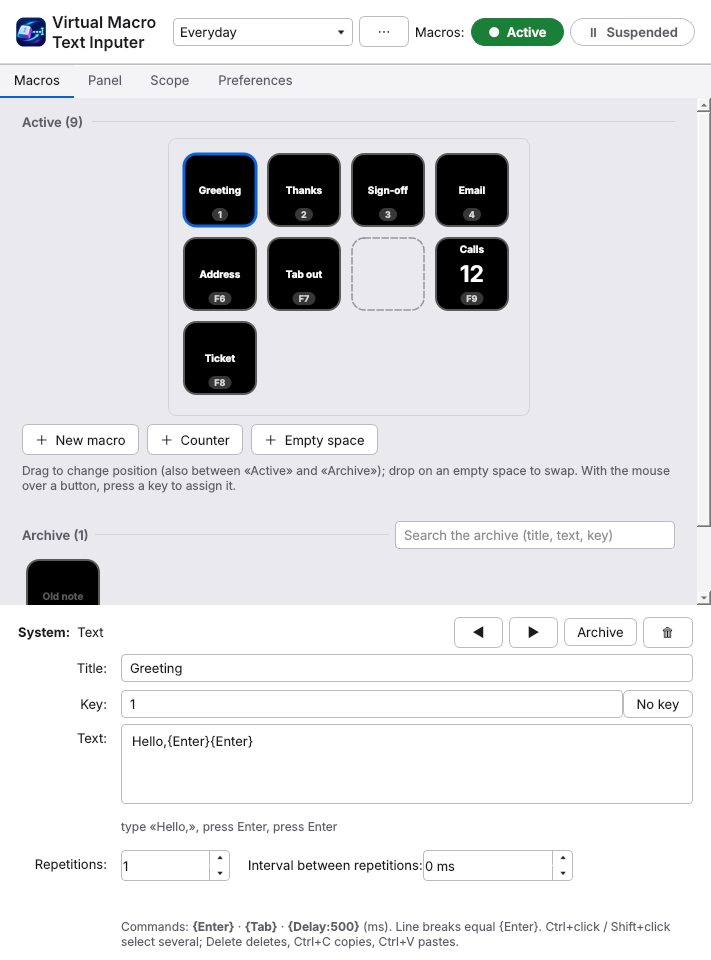
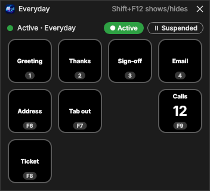

# Virtual Macro Text Inputer

*English version: [README.md](../../README.md). Os comandos e caminhos abaixo são relativos à raiz do repositório.*

> Feito em «vibe coding» com o Claude e revisto pelo Codex.
>
> Esta aplicação permite-me introduzir rapidamente pequenos excertos de texto clicando num botão de um painel transparente no ecrã ou premindo uma tecla de atalho. Pedi ao Claude que a construísse para responder a uma necessidade muito específica do meu trabalho. Inspirei-me muito no Virtual Stream Deck. Um dia esqueci-me de levar o meu Stream Deck físico e pedi ao Claude que recriasse o conceito em software. O Claude construiu as funcionalidades principais de uma só vez, sem erros que eu notasse.

<p align="center">
  
  &nbsp;
  
</p>

Um macro pad em software para Windows. Teclas normais do teclado (por omissão, 1–4 da fila superior) e um painel flutuante opcional escrevem texto pré-definido na aplicação que está em primeiro plano. Premir **1** escreve `3E03305`, e o próprio 1 não aparece.

## Funcionalidades principais

- **Texto numa tecla ou num botão.** Cada macro tem um título, uma tecla (ou nenhuma) e um texto, que pode incluir `{Enter}`, `{Tab}` e `{Delay:500}`.
- **Painel flutuante** que nunca tira o foco à aplicação onde está a escrever, com transparência ajustável, colunas, linhas e páginas, e estilos predefinidos.
- **Contadores**: botões que contam as pressões; mantê-los premidos repõe a contagem, com o progresso à volta da borda.
- **Botões multimédia**: Reproduzir/Pausa, faixa anterior/seguinte e volume, com ícones simples.
- **Conjuntos** de macros, cada um global ou limitado a aplicações escolhidas, com um Arquivo para as macros que não está a usar.
- **Edição confortável**: arrastar e largar, atribuir uma tecla pondo o rato sobre o botão e premindo-a, copiar/colar, anular uma eliminação, avisos de conflitos e duplicados.
- **Tecla global de suspensão** (`Shift+Escape`) e tecla do painel (`Shift+F12`), que funcionam mesmo a meio de uma macro.
- **Temas Diurno, Noturno e Automático**; interface em português e inglês.
- **Ficheiros TOML simples**, que pode editar à mão, recarregados automaticamente.

## Instalar

**Descarregar.** A página [Releases](https://github.com/gama20000/VirtualMacroTextInputer/releases) tem o `VirtualMacroTextInputer.exe`, um único ficheiro que não precisa de instalação nem de Python. Coloque-o onde quiser (por exemplo `%LOCALAPPDATA%\Programs\VirtualMacroTextInputer`) e execute-o. Não tem assinatura digital, por isso na primeira execução o Windows SmartScreen pode dizer «O Windows protegeu o seu PC»: **Mais informações ▸ Executar mesmo assim**.

**A partir do código** (Windows 10/11, Python 3.11 ou superior):

```powershell
git clone https://github.com/gama20000/VirtualMacroTextInputer.git
cd VirtualMacroTextInputer
.\run-dev.ps1              # executar a partir do código, com consola
.\build.ps1 -OneFile       # ou gerar dist\VirtualMacroTextInputer.exe
```

## Primeiros passos

1. Execute o programa. Aparece um ícone junto ao relógio; clique nele para abrir a configuração.
2. No separador *Macros*, selecione um botão, escreva o **Texto**, ponha o rato sobre o botão e prima uma tecla para a atribuir.
3. Prima essa tecla em qualquer aplicação, ou prima `Shift+F12` e clique no botão no painel.
4. `Shift+Escape` suspende e retoma todas as macros.

## Documentação

- [EXEMPLOS.md](EXEMPLOS.md): macros prontas a usar (formulários, repetições, contadores, um painel multimédia, conjuntos por aplicação).
- [ARQUITETURA.md](ARQUITETURA.md): o guia completo e a referência: todas as definições, opções avançadas, comandos, ficheiros de configuração, limitações, estrutura do código, compilação e testes.
- Documentos do projeto: [SPEC.md](SPEC.md), [ROADMAP.md](ROADMAP.md), [TASKS.md](TASKS.md), [ANSWERS.md](ANSWERS.md), [VERIFICACAO-MANUAL.md](VERIFICACAO-MANUAL.md), [revisao-codex.md](revisao-codex.md).

## Sobre

Até à versão 0.4 chamava-se **Macropad**; as definições dessa versão passam automaticamente no primeiro arranque ([detalhes](ARQUITETURA.md#migração-a-partir-do-macropad)). As releases são geradas e testadas pelo GitHub Actions numa máquina Windows limpa.

## Licença

MIT — ver [LICENSE](../../LICENSE).
